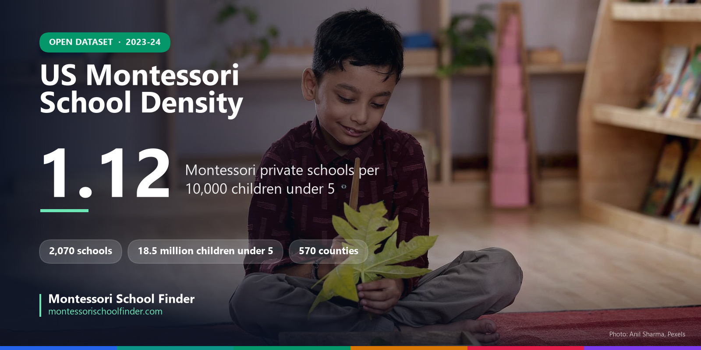
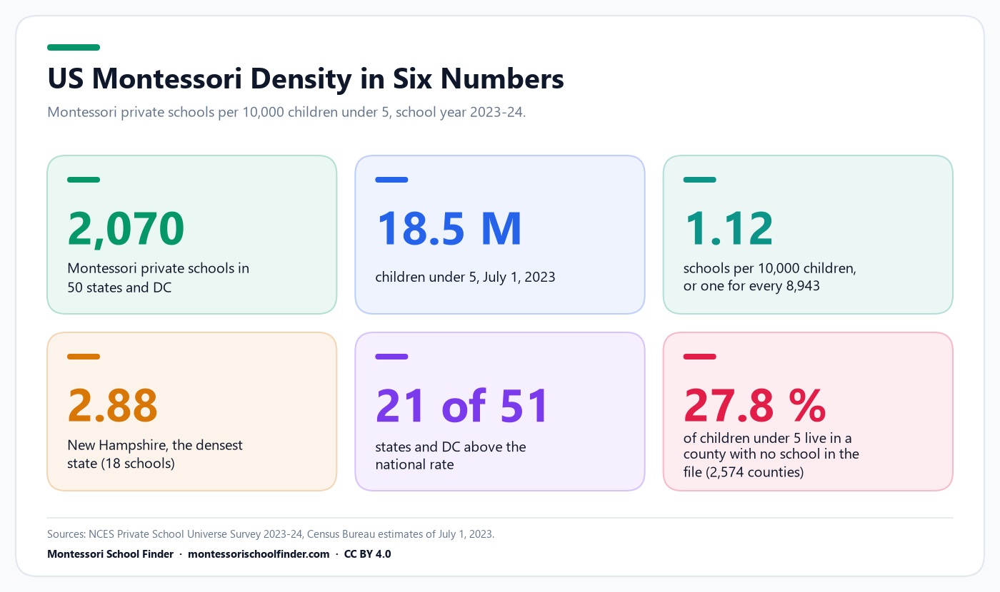
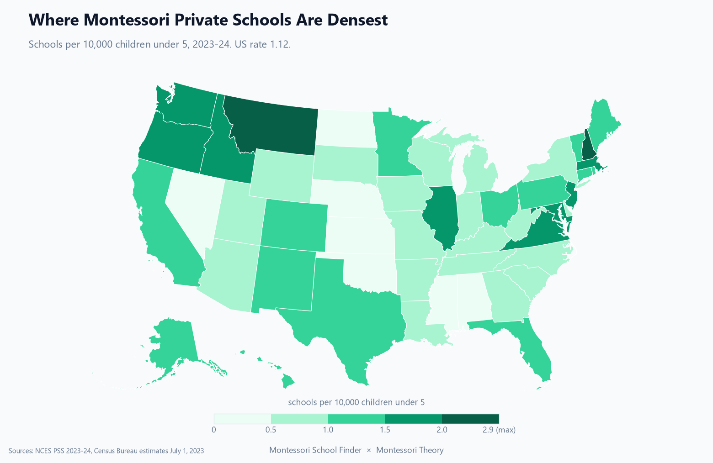
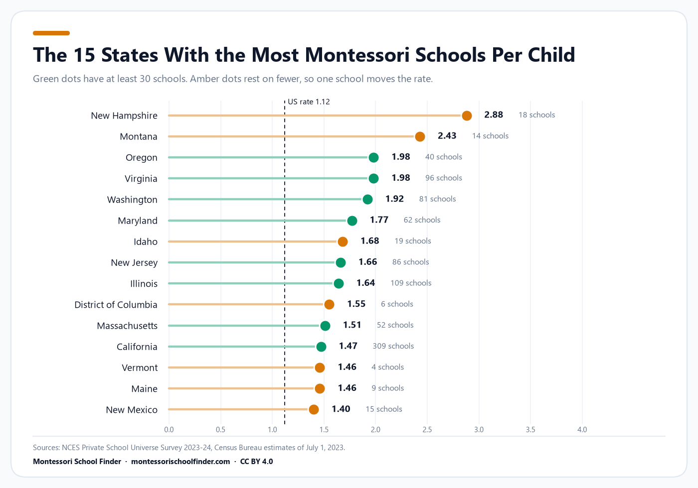
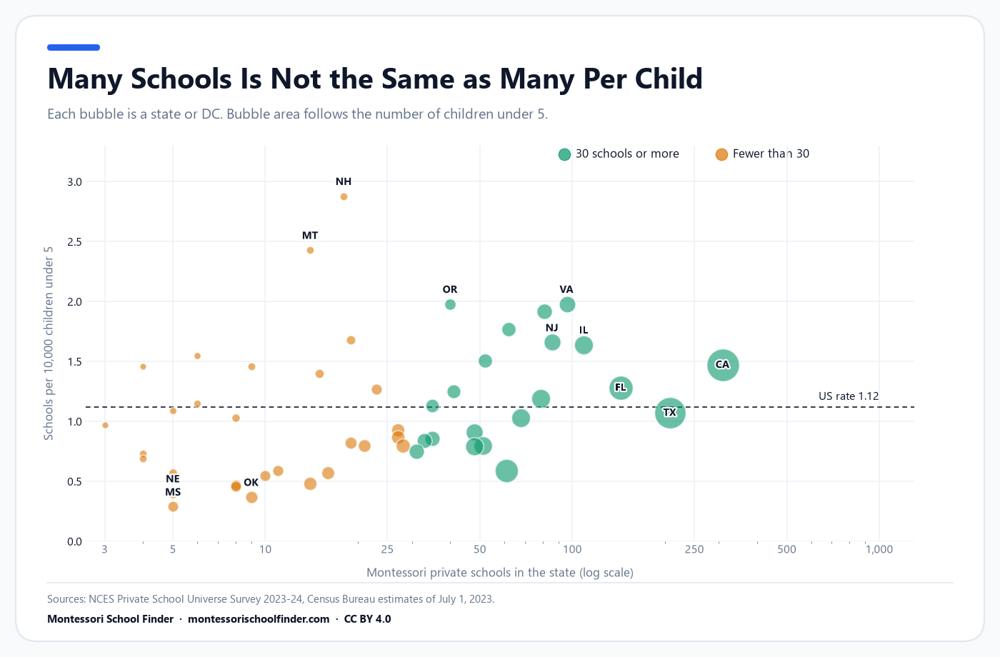
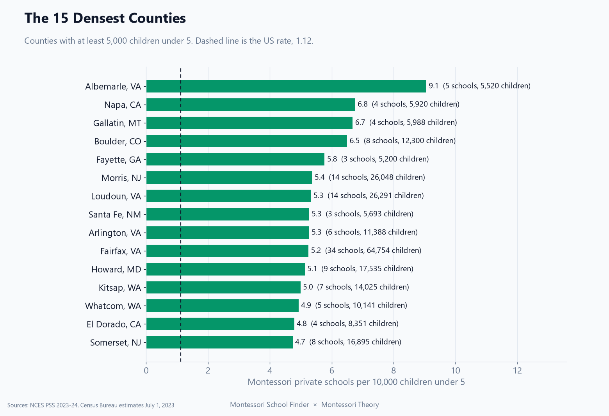

# US Montessori School Density by State and County, 2023-24

[](https://creativecommons.org/licenses/by/4.0/) [](https://nces.ed.gov/surveys/pss/) [](https://www.census.gov/programs-surveys/popest.html)



**English first, version française plus bas, resumen en español al final.**

An open dataset from **[Montessori School Finder](https://www.montessorischoolfinder.com/)**, the worldwide directory of Montessori schools.

## How Many Montessori Schools Does Your State Have For Its Children?

A raw count says California has the most Montessori private schools. It does not say where a family is most likely to find one nearby. This dataset divides the count by the number of young children, so a small state and a large state can be compared on the same scale.

For every state and for every county with at least one school, you get the number of Montessori private schools, the number of children under 5, and the rate **per 10,000 children under 5**, in ready-to-use CSV files.

### The Headline Numbers

|  |  |
|---|---|
| Montessori private schools, 2023-24 | 2,070 in 50 states and DC |
| Children under 5, July 1, 2023 | 18,511,160 |
| National rate | **1.12 schools per 10,000 children under 5**, or one school for every 8,943 children |
| Densest state | New Hampshire, 2.88 (18 schools) |
| Densest large state | Virginia 1.98, Washington 1.92, Maryland 1.77, New Jersey 1.66, Illinois 1.64 |
| Thinnest states | Mississippi 0.29, Oklahoma 0.37, Nebraska 0.40, North Dakota 0.41, Kansas 0.46 |
| Most schools | California 309, Texas 208, Florida 144, Illinois 109, Virginia 96 |
| States above the national rate | 21 of 51 |
| Densest county with a rate | Albemarle County, Virginia, 9.06 (5 schools) |
| Children under 5 in counties with no school in the file | 27.8 %, across 2,574 counties |

Count and rate tell different stories. California ranks first for schools and twelfth for rate. Texas ranks second for schools and twenty-third for rate. New Hampshire and Montana rank first and second for rate with only 18 and 14 schools.











### Top 10 States By Rate

| rank | state | schools | children under 5 | schools per 10,000 |
|---:|---|---:|---:|---:|
| 1 | New Hampshire | 18 | 62,585 | 2.88 |
| 2 | Montana | 14 | 57,574 | 2.43 |
| 3 | Oregon | 40 | 202,332 | 1.98 |
| 4 | Virginia | 96 | 485,946 | 1.98 |
| 5 | Washington | 81 | 421,127 | 1.92 |
| 6 | Maryland | 62 | 349,713 | 1.77 |
| 7 | Idaho | 19 | 113,383 | 1.68 |
| 8 | New Jersey | 86 | 519,070 | 1.66 |
| 9 | Illinois | 109 | 664,874 | 1.64 |
| 10 | District of Columbia | 6 | 38,586 | 1.55 |

### Top 10 States By Count

| rank | state | schools | schools per 10,000 | rank by rate |
|---:|---|---:|---:|---:|
| 1 | California | 309 | 1.47 | 12 |
| 2 | Texas | 208 | 1.07 | 23 |
| 3 | Florida | 144 | 1.28 | 16 |
| 4 | Illinois | 109 | 1.64 | 9 |
| 5 | Virginia | 96 | 1.98 | 4 |
| 6 | New Jersey | 86 | 1.66 | 8 |
| 7 | Washington | 81 | 1.92 | 5 |
| 8 | Pennsylvania | 79 | 1.19 | 19 |
| 9 | Ohio | 68 | 1.03 | 24 |
| 10 | Maryland | 62 | 1.77 | 6 |

Each state has its own page on Montessori School Finder, listed in the `msf_url` column of `by_state.csv`. For example, the [New Hampshire](https://www.montessorischoolfinder.com/locations/united-states/new-hampshire/) page and the [Virginia](https://www.montessorischoolfinder.com/locations/united-states/virginia/) page list the schools behind these numbers.

### Files

| file | content |
|---|---|
| `data/by_state.csv` | 51 rows (50 states and DC), schools, children under 5, rate, ranks, prekindergarten enrollment, link to the state page |
| `data/by_county.csv` | 570 counties with at least one school, 5-digit FIPS, rate for the 434 counties with at least 5,000 children under 5 |
| `data/national_summary.csv` | national totals and the checks behind the headline numbers |
| `data_dictionary.csv` | every column of every file |
| `source/` | the school counts and the private school total this dataset starts from |
| `scripts/` | `build_dataset.py`, `verify.py` and `make_charts.py` rebuild every table and image |
| `notebooks/starter.ipynb` | a starter notebook, already run |
| `images/` | the cover and the five visuals above |

### Columns

**by_state.csv**

| column | description |
|---|---|
| `rank` | Rank by schools per 10,000 children under 5. 1 is the densest |
| `state`, `state_name`, `state_fips` | Postal code, name and 2-digit FIPS code |
| `montessori_schools` | Montessori private schools in the PSS 2023-24 file |
| `children_under_5` | Children aged 0 to 4, Census Bureau estimate for July 1, 2023 |
| `schools_per_10k_under5` | Schools per 10,000 children under 5 |
| `children_under_5_per_school` | The same ratio the other way round |
| `rank_by_count` | Rank by number of schools |
| `prek_enrollment` | Prekindergarten pupils enrolled in these schools |
| `ams_member`, `ami_member` | Schools reporting AMS or AMI membership |
| `total_population`, `population_vintage` | Total population and the Census vintage used |
| `msf_url` | The state page on Montessori School Finder |

**by_county.csv**

| column | description |
|---|---|
| `county_fips` | 5-digit FIPS code. Read it as text to keep leading zeros |
| `county_name`, `state`, `state_name` | County and state |
| `montessori_schools` | Montessori private schools in the county |
| `children_under_5` | Children aged 0 to 4, July 1, 2023 |
| `rate_shown` | True when the county has at least 5,000 children under 5 |
| `schools_per_10k_under5` | Rate, empty when `rate_shown` is False |
| `rank_among_rated` | Rank among the 434 counties with a rate |
| `total_population` | Total population |

### Load It

```python
import pandas as pd

base = "https://raw.githubusercontent.com/montessoritheory/us-montessori-school-density/main/data"
states = pd.read_csv(f"{base}/by_state.csv")
states.sort_values("rank")[["state_name", "montessori_schools", "schools_per_10k_under5"]].head(10)

counties = pd.read_csv(f"{base}/by_county.csv", dtype={"county_fips": str})
counties[counties.rate_shown].head(10)
```

### How It Was Built

1. **School counts.** The numbers of Montessori private schools by state and county come from the [US Montessori Private Schools](https://github.com/montessoritheory/us-montessori-private-schools) dataset, which compiles the 2023-24 wave of the NCES Private School Universe Survey (PSS). A school counts when it says "Montessori" is its type of school, reports AMS, AMI or another Montessori association, or has "Montessori" in its name.
2. **Children.** The U.S. Census Bureau Population Estimates, **Vintage 2023**, county file `cc-est2023-agesex-all.csv`, reference date **July 1, 2023** (`YEAR` code 5 in the Census file layout), field `UNDER5_TOT` (ages 0 to 4). State figures are the sum of their counties. Download address: `https://www2.census.gov/programs-surveys/popest/datasets/2020-2023/counties/asrh/cc-est2023-agesex-all.csv`.
3. **Rate.** Schools divided by children under 5, times 10,000. Ranks use the unrounded rate.
4. **Counties.** Only counties with at least one school are listed. A rate is published only when a county has at least 5,000 children under 5. Below that, one school more or less moves the rate by 2 or more points, so the number says little. The 136 smaller counties keep their school count and have an empty rate. The 434 counties with a rate hold 1,906 of the 2,070 schools.
5. **Pairing.** Every one of the 570 county codes in the school file matched a county in the Census file, so no school was dropped.

The code in `scripts/` rebuilds everything from the two inputs.

### Checked Against The Source

- State school counts add up to 2,070, the national total of the school file, and so do county counts.
- State children counts are sums of county figures. They match the Census Bureau's separate state file (`sc-est2023-agesex-civ.csv`, ages 0 to 4) exactly for all 51 rows, including California (2,097,790), Texas (1,936,893), New Hampshire (62,585), Virginia (485,946) and Mississippi (173,870).
- All 570 county codes join to a county in the Census file.
- `scripts/verify.py` runs these checks.

### Read With Care

- **Private schools only.** Public Montessori schools (district and charter) are not in the PSS and not in this dataset. In states with many public Montessori programs, the real supply is higher than shown.
- **Kindergarten and above only.** The PSS covers private schools that offer kindergarten or a higher grade. A Montessori program for infants, toddlers or 3-year-olds only does not appear. The rate undercounts early programs.
- **Age groups do not line up.** The denominator counts children aged 0 to 4. Many of these schools teach older children too. The rate is a density measure, not a share of children enrolled.
- **Self-reported Montessori.** "Montessori" is the school's own answer in the survey. It does not mean AMS or AMI accreditation. Our guide to [AMI vs AMS](https://www.montessorischoolfinder.com/guides/ami-vs-ams/) explains the difference.
- **Small numbers.** New Hampshire, Montana, Vermont, Maine, Idaho and DC rank high or low on 18 schools or fewer. One school more or less changes their rank. In the state chart, amber dots flag those.
- **A county is not a commuting zone.** Families cross county lines, so a county with no school may sit next to one with several.
- **Counties without a school are not in `by_county.csv`.** 2,574 counties have none in the file, including 213 with at least 5,000 children under 5. Their count and the share of children who live in them are in `national_summary.csv`.
- **No state share of private schools.** The PSS school total by state is not part of the source files used here, so a Montessori share of private schools is given only for the nation (9.2 %).
- **Estimates have error.** Census figures are estimates. Small counties carry more uncertainty.
- **Counts, not quality.** The dataset says nothing about how good a school is.

### Image Credits

Cover photo by Anil Sharma on [Pexels](https://www.pexels.com/photo/40282981/), Pexels License. State outlines in the density map come from the Albers state file in `scripts/`. Charts by Montessori School Finder.

### License And Citation

**[CC BY 4.0](https://creativecommons.org/licenses/by/4.0/)**. Use it, share it and adapt it, commercially or not, and credit **Montessori School Finder** with a link to **[montessorischoolfinder.com](https://www.montessorischoolfinder.com/)**, along with the original sources below. Scripts are under the MIT License.

```bibtex
@misc{msf_us_montessori_school_density_2026,
  title  = {US Montessori School Density by State and County, 2023-24},
  author = {{Montessori School Finder}},
  year   = {2026},
  url    = {https://github.com/montessoritheory/us-montessori-school-density},
  note   = {Dataset, version 1.0, built from the NCES Private School Universe Survey and Census Bureau Population Estimates}
}
```

Sources. U.S. Department of Education, National Center for Education Statistics, [Private School Universe Survey (PSS)](https://nces.ed.gov/surveys/pss/), 2023-24. U.S. Census Bureau, [Population Estimates Program](https://www.census.gov/programs-surveys/popest.html), County Population by Characteristics, Vintage 2023. Both are US government works in the public domain.

---

## Version Française

### Densité des écoles Montessori aux États-Unis, par État et par comté, 2023-24

Ce jeu de données rapporte le nombre d'écoles Montessori privées au nombre d'enfants de moins de 5 ans, pour pouvoir comparer un petit État et un grand sur la même échelle.

- En 2023-24, **2 070 écoles Montessori privées** pour **18,5 millions d'enfants de moins de 5 ans**, soit **1,12 école pour 10 000 enfants**.
- Le New Hampshire (2,88), le Montana (2,43), l'Oregon (1,98), la Virginie (1,98) et l'État de Washington (1,92) ont la densité la plus forte. Le Mississippi (0,29) et l'Oklahoma (0,37) la plus faible.
- La Californie compte le plus d'écoles (309) mais n'est que 12e en densité.
- Le taux par comté n'est publié que pour les comtés ayant au moins 5 000 enfants de moins de 5 ans.
- Les écoles Montessori publiques ne sont pas incluses, et l'enquête ne couvre que les écoles qui accueillent à partir de la maternelle (kindergarten). Les programmes réservés aux bébés et aux tout-petits sont donc sous-comptés.

Licence CC BY 4.0, en citant **Montessori School Finder** avec un lien vers [montessorischoolfinder.com](https://www.montessorischoolfinder.com/), ainsi que les sources NCES et Census Bureau.

## Resumen En Español

### Densidad de escuelas Montessori en Estados Unidos, por estado y condado, 2023-24

Este conjunto de datos divide el número de escuelas Montessori privadas entre el número de niños menores de 5 años, para comparar estados pequeños y grandes en la misma escala.

- En 2023-24 hay **2.070 escuelas Montessori privadas** para **18,5 millones de niños menores de 5 años**, es decir **1,12 escuelas por cada 10.000 niños**.
- New Hampshire (2,88), Montana (2,43), Oregón (1,98), Virginia (1,98) y Washington (1,92) tienen la mayor densidad. Misisipi (0,29) y Oklahoma (0,37) la menor.
- California tiene más escuelas (309), pero es el 12.º en densidad.
- La tasa por condado solo se publica en los condados con al menos 5.000 niños menores de 5 años.
- No incluye escuelas Montessori públicas, y la encuesta solo cubre escuelas que ofrecen desde kindergarten, así que los programas solo para bebés y niños pequeños quedan subcontados.

Licencia CC BY 4.0, citando a **Montessori School Finder** con un enlace a [montessorischoolfinder.com](https://www.montessorischoolfinder.com/), y las fuentes NCES y Census Bureau.

---

**Part of the [Montessori School Finder open datasets](https://github.com/montessoritheory/montessori-schools-open-data).** Directory at [montessorischoolfinder.com](https://www.montessorischoolfinder.com/).
